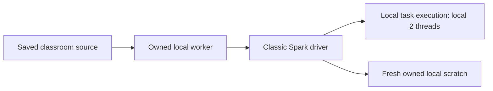
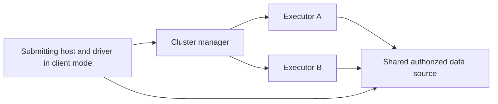
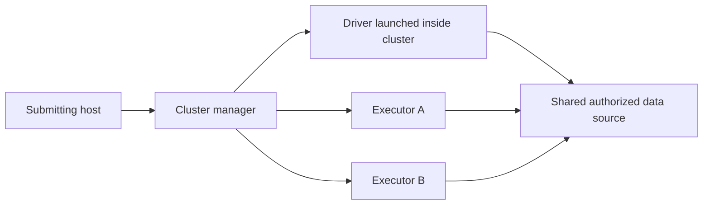

# spark-030: Deployment topology and dependency boundaries

This architecture lesson uses fixed, sanitized reasoning fixtures. It does not connect to a cluster, open a database, install dependencies or perform a deployment.

## Level and prerequisites

Advanced; approximately 120 minutes. Direct prerequisite: `spark-029`. The prepared execution baseline elsewhere in this course is classic Spark 4.0.1, Scala binary2.13 and JDK 17. This reading lesson distinguishes that actual local boundary from proposed remote designs.

## How to use this lesson

Read the mechanisms and two worked examples, then complete the [learner worksheet](../lessons/spark-030.md). Write one evidence-backed response per task before opening the [explained reference](../solutions/spark-030_solutions.md). The classroom reading profile does not execute the schematic examples. No remote account or service is required.

## Learning objectives

- Explain driver/executor responsibilities and distinguish local classic Spark from Connect and cluster deployment.
- Identify each responsibility, input boundary and missing acceptance receipt explicitly.
- Reject a plausible but unsupported design using concrete counterexamples and a bounded validation plan.

## Vocabulary and concepts

- **Driver:** The application process coordinating planning, scheduling and results; its placement depends on deployment mode.

- **Executor:** A process performing distributed tasks and holding task-local or cached data for an application.

- **Cluster manager:** The resource allocator that grants execution capacity; it is distinct from the application driver and SQL optimizer.

- **Client deploy mode:** A deployment in which the submitting environment hosts the driver, which must remain reachable by executors.

- **Cluster deploy mode:** A deployment in which the cluster launches the driver; its filesystem and environment differ from the submitting laptop.

- **Spark Connect:** A client/server interface transmitting unresolved logical plans and results, with a separate compatibility and API-support boundary from classic embedded Spark.

The classroom's local[2] worker is a specific classic Spark execution boundary. The driver and local task execution share one machine and the prepared process environment. That convenience can conceal assumptions that fail when driver and executors are separated. This lesson makes those assumptions visible before considering any remote deployment. Its diagrams and specification are fixed reasoning inputs, and none is a command to submit.



A transformation expressed in Python does not mean that every row is processed by ordinary Python code on the driver. DataFrame expressions describe work that Spark plans and executes. A scalar Python UDF introduces Python-worker execution at the relevant task boundary, while a driver-side collect brings results back to the driver. The previous lessons' bounded collects and local paths were safe only under their stated fixture and worker constraints.



In client deploy mode, the submitting environment hosts the driver. Executors must communicate with it, and losing that environment can affect the application. A local file on that host is not automatically available under the same path on executor machines. A shared data source, explicit file distribution or another documented mechanism is needed. The cluster manager allocates resources; it does not magically synchronize every local directory or make secrets safe to copy into source.



In cluster deploy mode, even the driver runs away from the submitting host. Driver-local relative paths, environment variables and Python imports must therefore be provided in the cluster driver's environment, not merely installed on the laptop that sends a submission request. The exact mechanisms depend on the cluster manager and packaging strategy. The lesson does not infer a working remote profile from a successful local worker receipt.

Dependencies have several boundaries. A Scala application artifact must match the selected Scala binary family and compatible Spark/JDK runtime. Python modules used in driver code must exist on the driver; modules imported by Python tasks must exist in executor Python environments. Simple Python source bundles can be distributed using supported Python-file mechanisms, but a wheel with native extensions is not interchangeable with a zip of pure Python source. Native libraries, interpreters and platform tags require an explicitly qualified environment distribution method.

Captured task closures are another boundary. A function sent to executors should capture small serializable configuration or immutable lookup data, not an open database connection, a SparkSession or a driver-local file handle. Task retries can repeat external side effects even if a local example ran only once. A connection needed by task code requires an explicit lifecycle and idempotency design, and credentials should come from an approved identity or secret mechanism rather than a hard-coded literal in a closure.

Spark Connect changes the architecture again. The client builds and sends logical plans to a server that manages Spark execution. Classic-only diagnostics such as _jdf, queryExecution and RDD-based APIs from earlier lessons are not automatically available through that boundary. A Connect implementation would need a separate adapter and tests for supported APIs, client/server versions, cancellation, result limits, authentication and lifecycle. Renaming the runtime profile or adding a server URL is not that implementation.

The sanitized specification below is a proposal to review. Its local path and dependency declarations expose deliberate gaps. It is not accepted configuration and should not be executed. A review can identify where each artifact must live and what receipt would qualify it, but only an actual bounded run can establish execution acceptance on the chosen platform.

```json
{
  "application": "bounded-course-product",
  "proposed_deploy_mode": "cluster",
  "spark_version": "4.0.1",
  "scala_binary": "2.13",
  "jdk_major": 17,
  "application_jar": "artifacts/course_2.13.jar",
  "python_bundle": "artifacts/rules.zip",
  "input_path": "/driver-local/input.parquet",
  "credential_source": "approved-runtime-identity",
  "expected_rows": 30,
  "maximum_collected_rows": 30
}
```

The strongest review separates the proposed design, inspected artifacts and actual receipts. It names the owner of each dependency and resource, preserves the exact input/output contract and defines a failure response. It also recognizes scope: this worksheet requires no cluster, cloud account, package download or deployment action.

## Worked example / walkthrough

### Worked example 1: A local path that does not cross the boundary

```text
Driver host: /driver-local/input.parquet exists
Executor host: same path absent
Task: read that path directly inside executor code
Expected observation: path availability is not established on the executor
```

The existence check proves only one host's local state. The corrected design must specify authorized shared storage or an explicit bounded distribution mechanism and verify it where the task runs. It must not claim that client deploy mode alone makes the file shared.

### Worked example 2: A classic diagnostic that needs a new adapter

```text
Existing lesson: frame._jdf.queryExecution().executedPlan()
Proposed client: Spark Connect
Available evidence: local classic worker receipt only
Review result: Connect diagnostic path is unimplemented and unqualified
```

The logical transformation may have a supported Connect equivalent while the internal JVM inspection does not. Keep the useful semantic oracle, replace the diagnostic boundary through supported capabilities, and qualify that adapter separately before presenting it as runnable.

## Exercises

### Exercise 1: Assign responsibilities in three deployment diagrams

Annotate the local, client-mode and cluster-mode diagrams with driver location, executor/task execution, resource allocation and result collection. Explain one failure introduced by moving the driver.

**Inputs/evidence:** For spark-030 Exercise 1, The three diagrams and the proposal stating cluster deploy mode.

**Expected result/shape:** For spark-030 Exercise 1, A role/location table for all three layouts, with collect returning to the driver wherever it runs and resource allocation assigned to the cluster manager.

**Verify:** Name every role and trace a collected 30-row result to the actual driver process in each layout; identify the submitting-host-loss or remote-driver-environment failure.

**Progressive hint:** Deploy mode changes driver placement; the cluster manager and executors do not become synonyms for the driver.

### Exercise 2: Repair a driver-only input path assumption

Review the proposed/driver-local/input.parquet path. State the visibility problem and specify a bounded replacement contract without choosing or contacting a real service.

**Inputs/evidence:** For spark-030 Exercise 2, The input path in the sanitized proposal and evidence that the file exists only on the submitting machine.

**Expected result/shape:** For spark-030 Exercise 2, An explicit data-location/distribution contract naming driver and executor visibility, authorization,30-row fixture identity and readback verification.

**Verify:** Reject automatic shared-path assumptions and list the exact host/process where existence and content must be checked.

**Progressive hint:** A path string is interpreted in a filesystem namespace; identical spelling does not imply identical storage.

### Exercise 3: Map dependencies to driver and executor environments

Produce a dependency matrix for the Scala jar, purePythonrules.zip, a hypothetical native-extension wheel and JDK/Spark runtime. State which proposed substitution is unsupported.

**Inputs/evidence:** For spark-030 Exercise 3, Spark 4.0.1, Scala binary 2.13, JDK 17, course_2.13.jar, rules.zip and an unqualified native-extension wheel.

**Expected result/shape:** For spark-030 Exercise 3, A matrix locating each dependency and its qualification evidence; reject a Scala 3 binary substitution and treating a native wheel as an ordinary pure-Python source zip.

**Verify:** Name compiler/binary family, Python interpreter/platform compatibility and worker import checks separately.

**Progressive hint:** A source archive can distribute modules without supplying an interpreter or native shared libraries.

### Exercise 4: Review a captured connection and a retrying task

Reject a task closure that captures an open driver database connection and writes one audit row per invocation. Propose separate serialization, lifecycle and idempotency contracts.

**Inputs/evidence:** For spark-030 Exercise 4, An open driver connection captured by a task function and evidence that a failed task can be retried.

**Expected result/shape:** For spark-030 Exercise 4, No connection object serialized from the driver; a defined task-side resource lifecycle if externalIO is later authorized, and a stable operation identity preventing duplicate external effects.

**Verify:** Explain why serializability alone would not guarantee exactly-once writes and name the cleanup and deduplication evidence needed.

**Progressive hint:** Task execution can repeat. Resource process ownership and external-write logical identity are separate issues.

### Exercise 5: Define the Connect adapter boundary honestly

Classify which existing classic capabilities can be assumed in a proposedConnect profile, and list the compatibility and lifecycle tests required before exposing it as ready.

**Inputs/evidence:** For spark-030 Exercise 5, The existing _jdf/queryExecution and RDD-based diagnostic helpers, plus the proposed remote logical-plan client.

**Expected result/shape:** For spark-030 Exercise 5, Classic internals are not assumed available; semantic goldens are retained while a separate supported diagnostic/runtime adapter is qualified.

**Verify:** List client/server version checks, API support, cancellation, result limits, authentication and cleanup receipts without claiming any already ran.

**Progressive hint:** A server URL does not implement the missing API and lifecycle boundary.

### Exercise 6: Write a reviewable deployment acceptance checklist

Turn the sanitized proposal into a go/no-go review record with explicit evidence tiers and rollback ownership. Keep the worksheet read-only.

**Inputs/evidence:** For spark-030 Exercise 6, All previous design findings, the 30-row/schema/digest contract and only an existing local classic runtime receipt.

**Expected result/shape:** For spark-030 Exercise 6, A bounded acceptance plan separating proposed configuration, artifact inspection, remote execution and production readiness; unresolved path/package/Connect gaps remain explicit.

**Verify:** Name concrete artifacts and receipts, owners and failure actions; do not mark deployment accepted based on diagram or syntax alone.

**Progressive hint:** A checked configuration is useful evidence but is not a completed remote run.

## Common pitfalls

Do not equate local[2] with a two-executor cluster. Do not assume driver files, imports or environment variables are executor-visible. Do not distribute secrets in source archives or captured closures. Do not assume a Scala binary suffix can be changed independently of the selectedSpark artifacts. Do not callConnect supported because a classic local transformation worked. Keep proposed architecture, artifact inspection, execution receipts and production acceptance as separate evidence.

## Self-check

Explain the first diagram or type mapping without reading the answer. Trace one failure through its actual process or storage boundary. State which observation would falsify your preferred design, which evidence already exists and which acceptance work remains. A correct vocabulary label alone does not complete the task.

## Next step

Continue through the [course route](../README.md). Preserve the written assumptions and evidence gaps when moving into a runnable lesson; a reviewed design is not an execution receipt.

## Primary sources and official APIs

- [Spark 4.0.1 cluster roles](https://spark.apache.org/docs/4.0.1/cluster-overview.html)

- [Spark 4.0.1 submitting applications and deploy modes](https://spark.apache.org/docs/4.0.1/submitting-applications.html)

- [Spark 4.0.1 Python package distribution](https://spark.apache.org/docs/4.0.1/api/python/tutorial/python_packaging.html)

- [Spark 4.0.1 Connect architecture](https://spark.apache.org/docs/4.0.1/spark-connect-overview.html)

## Ask an AI tutor about this lesson

```text
Use $guide-ds60sqlpy-learning to coach me through spark-030: Deployment topology and dependency boundaries.
Read courses/scala-spark/guides/spark-030.md and courses/scala-spark/lessons/spark-030.md. Direct prerequisites: spark-029.
Explain the new architecture or data-handling concepts, ask me to predict a concrete failure, then review my six worksheet responses. Give one hint at a time and ask retrieval questions in my own words. Require named roles, exact input/output contracts, counterexamples and inspectable acceptance evidence. Do not read solutions/ until I ask or have made an honest attempt.
This is a reading profile. Do not open remote connections, start services, install dependencies or apply the schematic configuration.
Done when all six task contracts have reviewed evidence and I can explain the assumptions, failure boundaries and unverified parts of the design.
```
