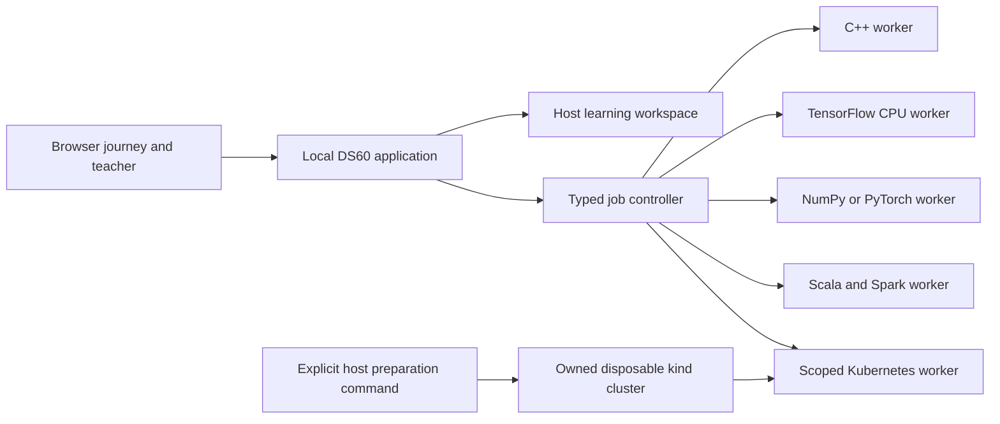

# Expansion architecture

Status: proposed implementation contract, 22 October 2026. Only the read-only journey preview is implemented in this phase. Worker, job, and progress-v2 interfaces below are designs, not available APIs.

## System boundaries

Keep the base browser app, existing Python pads, PostgreSQL lessons, progress storage, and offline documentation small. Add optional, independently versioned workers for C++, TensorFlow, PyTorch, Scala/Spark, and Kubernetes. A learner preparing one course should not need every compiler or machine-learning library.

This diagram shows logical components, not an approved Docker Compose topology. In particular, the application must not receive the Docker daemon socket or a host administrator kubeconfig. The existing application executes trusted local learner code and is not a multi-user hostile-code sandbox. New workers need an explicit threat model before any remote or classroom hosting.

## Profiles and compatibility

| Profile ID | Purpose | Dependency boundary |
| --- | --- | --- |
| `reading` | Concepts and explanation | No execution dependencies |
| `python-core` | NumPy foundations and tiny LLM mathematics | Existing core Python environment |
| `cpp20` | Compile, test, debug, measure | Linux compiler, C++20 standard library, CMake, CTest |
| `tensorflow-cpu` | TensorFlow/Keras training | Separate Python environment and locked numerical packages |
| `llm-torch-cpu` | Tiny transformer implementation | Separate CPU PyTorch environment; reuse existing course knowledge |
| `scala-jvm` | Scala language foundations | Explicit Scala and JDK toolchain |
| `spark-local-scala` | Spark in Scala | Matched Spark, Scala binary version, JDK, fixture formats |
| `spark-local-python` | PySpark parity | Same Spark/JDK plus pinned Python; Arrow/pandas compatibility for labs that enable them |
| `k8s-kind` | Reconciliation and operational labs | Host-owned kind cluster; scoped worker identity |

The existing `deep-learning` Python extra means PyTorch. Do not silently redefine it as TensorFlow or install incompatible TensorFlow requirements into the core environment. Current core NumPy constraints and any framework-specific Python/wheel limits must be resolved in the relevant isolated lock, then verified on each target architecture. A documentation version tuple is a proposal until its lock and image execute successfully.

Default supported targets for future worker images are Linux amd64 and arm64. Windows uses a Linux-container engine with WSL2; macOS uses the engine's Linux VM. Native Windows, Apple Clang, GPU acceleration, distributed multi-node Spark, and externally managed Kubernetes are separate compatibility rows. An amd64 image working under emulation does not establish native arm64 support. See each track's primary references and qualification gates.

## How the application reaches a worker

For the Docker route, the host launcher prepares and starts optional worker services through fixed Compose profiles. The application talks to an enabled worker over a private engine network using a bounded, authenticated job protocol. Worker ports are not published to the host. Workers have their own locked toolchain images and no engine socket. The host launcher, not application code or lesson content, owns image builds, service creation, networks, and teardown. This avoids relying on `host.docker.internal`, which is not a universal engine contract.

Initially a worker accepts one job at a time under its container resource limit. It receives bounded UTF-8 source files and immutable fixture references through typed messages, with normalized relative paths, size limits, a job nonce, and an allowlisted operation. It never mounts the whole repository or learner home. Output artifacts return through size-limited, hash-checked messages and are saved by the application to its host-mounted learning workspace. Worker authentication material lives in private runtime-session mounts, outside portable progress. A future multi-user service would require a stronger per-job isolation design.

For native application mode, the same host launcher may expose a loopback-only authenticated worker gateway on an explicitly chosen port; browser code still uses only the application API. Qualify that topology separately. The default Docker topology needs no host gateway alias. Kubernetes preparation attaches its scoped worker to the owned cluster network and supplies an internal control-plane endpoint. Advanced privileged fixture actions remain fixed host-launcher operations with lease checks, not a general remote-shell API.

A browser cannot install host tools or start a stopped engine by itself. Until a separately authenticated host companion exists, the Prepare screen gives the relevant launcher action, progress-file location, and readiness probe instructions. An existing host wizard can perform the action when invoked by the user. Never display a working one-click Prepare button that has no implemented host channel.

## Job lifecycle

The existing short synchronous pads cannot represent compilation, training, streaming, or cluster reconciliation reliably. Introduce asynchronous, typed jobs before promoting those labs.

Proposed lifecycle: `queued -> preparing -> compiling (when needed) -> running -> verifying -> succeeded`. Terminal alternatives are `failed`, `cancelled`, `timed_out`, `blocked`, and `expired`. Persist state transitions atomically. A process exit of zero is one observation; only an executed verifier can produce verification evidence. A successful job does not mark learner mastery.

Each request binds a stable lesson ID and exercise ID to a registered operation. The controller records source hash, input fixture hashes, profile version, image digest, verifier version, deterministic seed where relevant, timestamps, exit status, resource limits, and artifact hashes. Never accept arbitrary shell commands, image names, host mount paths, or interpreter flags from lesson JSON or browser requests.

Proposed endpoints are `POST /api/jobs`, `GET /api/jobs/<id>`, `POST /api/jobs/<id>/cancel`, and an allowlisted artifact download. These do not exist yet. Preserve the current loopback binding, Host/origin validation, session token, CSP, and path protections when implementing them. Validate body size and all types before creating a job. A repeated submit uses an idempotency key; after a crash, inspect the owned worker before deciding whether to mark the job interrupted. Never automatically replay a side-effecting job.

Compilation and execution have separate deadlines. Logs retain bounded head and tail with explicit truncation; a truncated stream cannot conceal failure or turn a job green. Preserve compiler diagnostics and source locations. Cancellation reaps descendants and removes only owned disposable resources. Scratch directories have byte limits, job isolation, and expiry. Read-only fixtures and toolchains are separate from writable outputs. Set CPU, memory, process, and storage limits rather than relying on container defaults. Docker containers have no resource constraints by default. [Docker resource constraints](https://docs.docker.com/engine/containers/resource_constraints/)

## Kubernetes ownership

Preparation is a host-side action that creates a labelled disposable kind cluster and a unique learner namespace. The host companion retains bootstrap authority outside the browser application. A worker receives only the short-lived credentials necessary for its lesson and connects to the cluster's internal endpoint on the controlled engine network. Do not pass a host `127.0.0.1` cluster endpoint into a worker and assume it resolves to the host.

Normal labs use namespaced permissions. CRDs, admission, RBAC escalation demonstrations, node failure, and other cluster-wide work require a dedicated advanced cluster lease. Never run against the learner's ambient context. Record cluster identity, namespace UID, ownership labels, lease expiry, and expected network before changing resources. Cleanup checks all ownership markers, and refuses ambiguous resources.

Credentials belong in private ephemeral host-session files or read-only worker mounts, never the portable `.learning` tree. Whole-workspace backups must not collect service-account tokens. `.learning/resources/` may contain nonsecret ownership receipts and expiry metadata only. No privileged containers, host filesystem mounts, host network, or daemon socket in ordinary labs. Advanced exceptions require a lesson-specific design and visible resource boundary.

## Persistence and offline operation

Preserve the current host-mounted `.learning` contract across container replacement. Proposed progress-v2 adds independent per-exercise attempts, predictions, explanations, review scheduling, verifier receipts, and self-assessment. Keep existing lesson IDs and notes. Migration must back up the original file, validate the new file, and support recovery. Never translate an old self-reported completion into machine-verified mastery.

Store large generated models and Spark outputs separately from small progress records, with an explicit size and retention policy. Import/export validates relative paths, schemas, size, and hashes, and excludes credentials and executable hooks. Progress remains readable when an optional worker is absent.

Preparation may download pinned, licensed assets with visible size and provenance. Ordinary practice then runs offline against prepared images and fixtures. No default external model endpoint, cloud account, paid API, or multi-gigabyte checkpoint. A readiness screen distinguishes missing image, incompatible architecture, missing fixture, insufficient resources, stopped engine, and successful local probe. A configuration file alone cannot say Ready.
