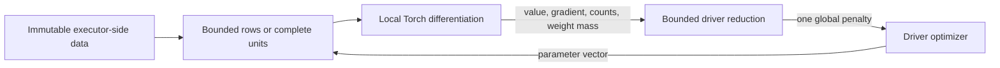

# DS60 Spark Likelihood

`ds60-spark-likelihood` is an independent Python package for fitting custom low-dimensional likelihoods with Spark and PyTorch. Spark schedules complete independent contributions, Torch differentiates local CPU float64 calculations, and a driver optimizer receives bounded numerical summaries. There is no R or classroom-server dependency.

Version 0.1.0 was the first package release. Version 0.2.0 adds a separate bounded CPU executor training namespace, `ds60_torch_training`. The row kernel preserves the separately tested objective, gradient, reduction, weighting, empty-partition and optimizer contracts. A distinct complete-unit protocol preserves joint likelihoods; scalar group losses must never be sent through the row-batching kernel. Cross-group latent covariance and a differentiable Spark SQL plan are different problems and are not implied by this package.

## Install from the package directory

Copy this entire folder into a fresh project, enter that folder, and run:

```bash
python -m pip install .
```

The core contracts use the Python standard library. Install optional dependencies explicitly before execution, never inside a fit:

```bash
python -m pip install '.[spark,torch,scipy]'
```

The extras declare compatible interfaces; they are not a pinned CPU environment. Spark also needs a compatible Java runtime. Choose the Torch distribution deliberately during preparation. The package owns exact CPU/scientific/build locks and a standalone Docker recipe in [runtime preparation](docs/PREPARATION.md). Neither installing the package nor selecting a Torch extra promises GPU support. Native qualification records actual versions and architecture separately.

## Prepare the complete CPU image

```sh
docker build --tag spark-likelihood:0.2.0 .
```

The build context is this package alone. Neutral public Python and Spark bases,
exact package-local CPU dependencies, noneditable wheel installation and explicit
source-checked Spark launcher preparation replace any parent-checkout dependency.
The recipe supports reviewed offline wheelhouses and explicit prepared-image
compatibility overrides. Model execution never installs packages or patches Spark.

Qualification of the new neutral default bases is still pending. An existing
prepared classroom image is only an optional compatibility input; its earlier
receipt does not qualify a different Docker build. Read [preparation](docs/PREPARATION.md)
and [tooling](tooling/README.md) before selecting the network/offline path. Use
[integration](integration/README.md) for the separate master/two-worker/driver
acceptance procedure; a built image alone is not distributed execution evidence.
The [CPU training integration harness](training-integration/README.md) has a
separate one-wheel executor and worker-loss acceptance route.

## Additive row likelihoods

```python
from pyspark.sql import SparkSession
from ds60_spark_likelihood.models import normal_mean
from ds60_spark_likelihood.spark_backend import SparkObjective
from ds60_spark_likelihood.optimization import minimize_lbfgsb

spark = SparkSession.builder.master("local[2]").appName("likelihood-example").getOrCreate()
# Each row contains model features, then a scalar target and a nonnegative weight.
rows = spark.sparkContext.parallelize([(1.0, 1.0), (2.0, 1.0), (4.0, 1.0), (7.0, 1.0)], 2)
with SparkObjective(rows, normal_mean()) as objective:
    result = minimize_lbfgsb(objective.evaluate, [0.0, 0.0])
    print(result.parameters, result.gradient_inf_norm, result.converged)
spark.stop()
```

A custom `TorchLoss` supplies one differentiable value per observation. It must be deterministic and independent of batch composition. Observations remain on executors; the driver collects bounded partition summaries. Unequal partitions carry their true weight masses. A global penalty is added once after the declared sum or weighted-mean reduction.

An optimizer success flag is not a proof of identification, correct sampling assumptions or calibrated prediction intervals. Inspect raw and projected gradient norms, bounds, numerical oracles and the scientific unit of independence.

## Development

```bash
python -m pip install -e '.[test,scipy]'
python -m pytest tests
python -m pip wheel --no-deps --no-build-isolation . --wheel-dir dist
```

Build and test the wheel independently from the parent classroom application. Installed-wheel checks must not rely on a repository `PYTHONPATH` or the old compatibility imports. `ds60sqlpy.spark_likelihood` contains only migration aliases; canonical implementations live here. No PyPI publication is performed by these commands.

## Model and execution contracts

Read [objectives and complete units](docs/objectives.md), [custom model authoring](docs/custom-models.md), [the Gamma-Poisson custom group model](docs/gamma-poisson.md), [distributed training](docs/distributed-training.md), and [CPU executor training](docs/CPU-TORCH-TRAINING.md). They distinguish row likelihoods, joint independent groups, shared versus separate parameters, explicit point-prediction targets and large neural-network training. The exact Gaussian random-intercept example runs entirely in Torch; it does not require R or imply support for arbitrary Laplace approximations.

Qualification has separate layers: source tests, installed-wheel import isolation, numerical oracles, actual local Spark tasks and DataFrame/ML persistence. Native architecture and dependency versions belong to the retained execution receipts. Tiny CPU examples do not establish remote-cluster or GPU performance.



The driver receives summaries, not the observations. This diagram describes the low-dimensional likelihood path; DDP training has a separate execution and sharding contract.

## DataFrame and ML interfaces

The [DataFrame and ML guide](docs/DATAFRAME-ML.md) documents `DataFrameObjective`, `SparkLikelihoodEstimator` and `SparkLikelihoodModel`. Feature columns, target labels, row weights and unit weights have distinct roles. Complete units preserve their grouping and declared ordering. Saved models use JSON configuration, parameters and full model descriptors; they require trusted registration on load and do not deserialize executable pickles.
